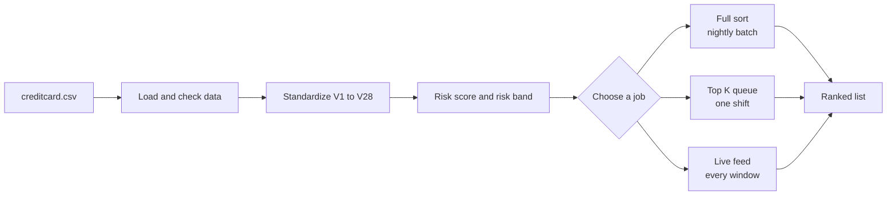

<p align="center">
  
</p>

# Fraud Risk Ranking Engine

<p align="center">
  
  
  
  
  
</p>

The Fraud Risk Ranking Engine ranks payment transactions by estimated risk. Fraud analysts can review only a limited number of transactions in each shift, so the riskiest transactions must come first.

The engine is written in C++17. It builds a risk score for every transaction, sorts the full list with five algorithms, picks the top K with two faster methods, and keeps a live queue up to date as new transactions arrive.

## Contents

- [How it works](#how-it-works)
- [Quick start](#quick-start)
- [Risk score and ranking order](#risk-score-and-ranking-order)
- [Algorithms](#algorithms)
- [Test inputs](#test-inputs)
- [Results](#results)
- [Analyst Console](#analyst-console)
- [Run the experiments](#run-the-experiments)
- [Project layout](#project-layout)
- [Debugging](#debugging)
- [Limits and notes](#limits-and-notes)

## How it works



| Job | What it does | Best method found |
|---|---|---|
| Full sort | Ranks every transaction of a day | Merge Sort |
| Top K queue | Finds only the first K transactions for a shift | Size K min heap |
| Live feed | Updates the queue after every time window | Size K min heap fed with new records only |

## Quick start

You need a Windows computer with PowerShell, MinGW (g++), and Python. The compiler setup adds MSYS folders to `PATH`, which can make `python` select the MSYS copy. Set a variable to your regular Windows Python executable and use it for Python commands. This example matches Python 3.12 from the error output. Change the version or path if yours is different:

```powershell
$PythonExe = "$env:LOCALAPPDATA\Programs\Python\Python312\python.exe"
& $PythonExe -m ensurepip --upgrade
& $PythonExe -m pip install -r requirements.txt
```

**1. Get the data.** Download `creditcard.csv` from the [Kaggle credit card fraud page](https://www.kaggle.com/datasets/mlg-ulb/creditcardfraud) and put it in the project folder. The file is not part of this repository. Check the licence terms on the Kaggle page.

**2. Open PowerShell in the project folder and make the compiler visible:**

```powershell
$env:Path = "C:\msys64\mingw64\bin;C:\msys64\usr\bin;$env:Path"
New-Item -ItemType Directory -Force build | Out-Null
```

Change the MinGW path if you installed it somewhere else.

**3. Build the programs:**

```powershell
g++ -std=c++17 -O2 -Wall -Wextra -Wpedantic -I include src\profile.cpp -o build\queue_profile.exe
g++ -std=c++17 -O2 -Wall -Wextra -Wpedantic -I include tests\test_algorithms.cpp -o build\queue_tests.exe
g++ -std=c++17 -O2 -Wall -Wextra -Wpedantic -I include src\experiment_runner.cpp -o build\queue_experiments.exe
g++ -std=c++17 -O2 -Wall -Wextra -Wpedantic -I include src\analyst_console.cpp -o build\analyst_console.exe
```

**4. Run the tests and the data profile:**

```powershell
.\build\queue_tests.exe
.\build\queue_profile.exe .\creditcard.csv
& $PythonExe analysis\problem_a.py creditcard.csv --out results\problem_a
```

If the tests pass, the test program prints nothing. The C++ profile prints the transaction count, fraud count, Amount statistics, risk band counts, and a check of the ranking order.

A `CMakeLists.txt` is also included for CMake 3.16 or newer. The direct `g++` commands above work without CMake.

## Risk score and ranking order

For each feature V1 to V28, the program finds the mean and the population standard deviation (`ddof=0`) over the full file. Then for every transaction:

1. Turn each feature into a z score: `(value - mean) / standard deviation`.
2. Square the 28 z scores and add them. This is the **risk score**.
3. Take the base 2 logarithm of the score, round down, and keep it between 0 and 9. This is the **risk band**. A score of zero goes to band 0.

Transactions are ranked with this order, so every correct sort gives exactly the same output:

| Step | Rule |
|---|---|
| 1 | Risk band, high to low |
| 2 | Amount, high to low |
| 3 | Time, early to late |
| 4 | Transaction ID, low to high |

The transaction ID is the row number in the file, starting at 1. The `Class` column marks fraud. It is used **only** to measure how many frauds a queue catches. It is never used to calculate risk or to sort.

## Algorithms

All algorithms are written from scratch in `include/midnight_queue/algorithms.hpp`. No library sort is used inside them.

| Algorithm | Idea | Time (typical) | Extra memory |
|---|---|---|---|
| Insertion Sort | Insert each record into the sorted part | n squared, but n on ranked input | None |
| Merge Sort | Split, sort halves, merge | n log n always | n records |
| Naive Quick Sort | Last item as pivot, Lomuto partition | n log n, but n squared on ranked input | log n stack |
| Hardened Quick Sort | Median of three pivot, three way partition | n log n on most inputs | log n stack |
| Heap Sort | Build a heap, take the top again and again | n log n always | None |
| Top K with size K min heap | Keep the best K seen so far in a small heap | about n, up to n log K | K records |
| Top K with bounded insertion buffer | Keep a sorted list of K records | up to n times K | K records |

Both Quick Sorts work on the smaller side first and loop on the larger side, so the stack stays small and sorted input does not crash them.

Counting rules used in all measurements:

- A **comparison** is one call of the ranking comparator.
- A **move** is one assignment of a record into a slot owned by the algorithm. A swap counts as 3 moves.

## Test inputs

The same records are used to build six input conditions. Samples are drawn uniformly without replacement with seed `2013`, then put back into Time order.

| ID | Name | How it is built |
|---|---|---|
| C1 | Arrival | Sampled rows in Time order |
| C2 | Shuffled | C1 shuffled with the seeded random generator |
| C3 | Pre-ranked | C1 sorted by the full ranking order |
| C4 | Reverse-ranked | Exact reverse of C3 |
| C5 | Nearly ranked | C3 with 1 percent of records moved to random places |
| C6 | Band-only | C1 order, but the sort key is the risk band alone |

Sample sizes are 1,000, 10,000, 100,000, and 284,807 (the full file). Every algorithm gets a fresh copy of identical input. Reported times are the median of 5 runs and exclude file reading and risk score calculation.

## Results

The refreshed five-trial measurements are in `results/experiments_final_v2` and the submission copy is `results.csv`. The run used MinGW GCC 16.2.0, C++17, `-O2`, on Windows 11 x64.

### Building a top 230 queue

The size K min heap was the fastest method at every tested point, including K = n/10. Every five-trial run completed within the five minute limit. At n = 284,807, the bounded insertion buffer took 5.28 to 5.37 seconds for K = 2,068, 6.15 to 9.47 seconds for K = 5,000, and 56.67 to 72.82 seconds for K = 28,480.

### Full sort on 284,807 shuffled transactions

| Algorithm | Median time |
|---|---|
| Naive Quick Sort | 0.063 s |
| Merge Sort | 0.091 s |
| Hardened Quick Sort | 0.089 s |
| Heap Sort | 0.157 s |
| Insertion Sort | 111.079 s |

All five methods finished every condition at the full size. The fastest method varied by condition. Naive Quick Sort led on C1 and C2, Merge Sort led on C4 and C5, and Hardened Quick Sort led on C6.

### Live feed over 48 hours (1 hour windows)

| Strategy | Final cumulative time | Peak extra memory |
|---|---|---|
| Re-rank everything with Merge Sort | 2.60 s | 35,006,336 bytes |
| Maintain a size K min heap | 0.0045 s | 14,720 bytes |
| Merge Sort each window, merge into top K | 0.127 s | 1,055,936 bytes |

For 10 minute windows, the final cumulative times were 8.67 seconds for full re-ranking, 0.0080 seconds for the heap, and 0.0659 seconds for sorting each window and merging. The heap also used the least extra memory.

The final C, D, and E tables, SVG plots, prediction log, and detailed report are in `results/experiments_final_v2`. The report PDF is `2013-A2-A.pdf`.
| Size K min heap fed with new records | 0.006 s | 14,720 bytes |

### How many frauds does the queue catch?

Using `Class` only for evaluation:

| Queue size K | Frauds caught | Share of all 492 frauds |
|---|---|---|
| 230 | 3 | 0.6 percent |
| 500 | 63 | 12.8 percent |
| 2,068 | 246 | 50 percent |
| 5,000 | 361 | 73.4 percent |
| 28,480 | 438 | 89.0 percent |

The smallest queue that catches half of the frauds has K = 2,068. A faster algorithm does not change this number. Only a different ranking rule would.

### Data profile

- 284,807 transactions and 492 frauds.
- No missing, nonnumeric, or nonfinite values. No row was dropped or filled.
- 1,081 repeated full rows are kept, because each row is a separate transaction.
- 32,767 distinct Amount values. The 10 most common values cover 16.29 percent of rows.
- The raw file is in nondecreasing Time order. It is not already in ranking order or in the exact reverse.

| Risk band | 2 | 3 | 4 | 5 | 6 | 7 | 8 | 9 |
|---|---|---|---|---|---|---|---|---|
| Transactions | 21,156 | 107,410 | 113,116 | 32,084 | 6,006 | 2,797 | 1,376 | 862 |
| Frauds | 0 | 13 | 30 | 23 | 56 | 97 | 112 | 161 |

Bands 0 and 1 are empty. See `results/problem_a/risk_band_histogram.png` for the chart.

For the full details and limits, read `results/experiments/REPORT.md`.

## Analyst Console

A small local web page lets an analyst:

- choose the method: Full Sort with Merge Sort, Size K Min Heap, or Bounded Insertion Buffer
- set K (default 230)
- see the top K transactions with transaction ID, risk band, Amount, and Time
- see the run time, comparison count, and move count of the run

The Python file only serves the page and calls the C++ program. All ranking stays in C++.

Build `analyst_console.exe` (see Quick start), then start the page from the project folder:

```powershell
& $PythonExe analysis\analyst_console.py
```

Open `http://127.0.0.1:8000` in a browser. Keep the PowerShell window open while you use the page. Press `Ctrl+C` to stop it. The server listens only on your own computer. Large K values can make the bounded insertion buffer slow.

To use another data file, port, or program:

```powershell
& $PythonExe analysis\analyst_console.py --data .\creditcard.csv --exe .\build\analyst_console.exe --port 8000
```

## Run the experiments

Run all experiments into a new folder. The runner uses the assignment's five minute per-run DNF limit by default:

```powershell
.\build\queue_experiments.exe .\creditcard.csv --problem all --out results\experiments_new
```

For a short development run, you can choose a smaller limit, for example `--timeout-seconds 30`. Do not use that shorter limit for final assignment measurements. The final C and D results were collected with the default five minute limit. All trials completed, with no DNF rows.

Or run one part at a time. Use the same output folder so each part adds its rows:

```powershell
.\build\queue_experiments.exe .\creditcard.csv --problem C --out results\experiments_new
.\build\queue_experiments.exe .\creditcard.csv --problem D --out results\experiments_new
.\build\queue_experiments.exe .\creditcard.csv --problem E --out results\experiments_new
```

| Option value | Experiment |
|---|---|
| `C` | Full sorting of all five algorithms on every input condition and size |
| `D` | Top K: full sort, size K min heap, bounded insertion buffer |
| `E` | Live feed with 1 hour and 10 minute windows |
| `all` | All of the above |

The `--smoke` option runs a small sample to check that everything works. Smoke results are not real measurements.

## Project layout

```text
fraud-risk-ranking-engine/
|-- analysis/
|   |-- analyst_console.py
|   |-- build_report.py
|   |-- package_submission.py
|   |-- problem_a.py
|   `-- summarize_results.py
|-- assets/
|   `-- header.svg
|-- include/
|   `-- midnight_queue/
|       |-- algorithms.hpp
|       |-- dataset.hpp
|       |-- experiment_data.hpp
|       |-- record.hpp
|       `-- svg_plot.hpp
|-- results/
|   |-- experiments_final_v2/
|   |   |-- C_summary.csv
|   |   |-- D_summary.csv
|   |   |-- E_summary.csv
|   |   |-- REPORT.md
|   |   |-- prediction_log.csv
|   |   |-- results.csv
|   |   `-- requested SVG plots
|   `-- problem_a/
|       |-- risk_band_distribution.csv
|       |-- risk_band_histogram.png
|       `-- summary.json
|-- src/
|   |-- analyst_console.cpp
|   |-- experiment_runner.cpp
|   `-- profile.cpp
|-- tests/
|   `-- test_algorithms.cpp
|-- CMakeLists.txt
|-- 2013-A2-A.pdf
|-- 2013-A2-A.zip
|-- results.csv
|-- PLAN.md
|-- requirements.txt
`-- README.md
```

| Path | Purpose |
|---|---|
| `include/midnight_queue/record.hpp` | Transaction record and ranking rules |
| `include/midnight_queue/algorithms.hpp` | Sorting algorithms, Top K methods, comparison and move counters |
| `include/midnight_queue/dataset.hpp` | CSV loading, standardizing, risk score, and risk band |
| `include/midnight_queue/experiment_data.hpp` | Seeded sampling and the six input conditions |
| `include/midnight_queue/svg_plot.hpp` | SVG line and bar charts for the experiments |
| `src/profile.cpp` | Command line data profile |
| `src/experiment_runner.cpp` | Benchmark runner for the experiments |
| `src/analyst_console.cpp` | C++ queue builder used by the web page |
| `tests/test_algorithms.cpp` | Correctness tests |
| `analysis/analyst_console.py` | Local web page server |
| `analysis/problem_a.py` | Data checks, statistics, and the risk band histogram |
| `analysis/summarize_results.py` | Creates compact C, D, and E result tables |
| `analysis/build_report.py` | Rebuilds the experiment report and charts |
| `analysis/package_submission.py` | Creates the curated source ZIP without data or build files |
| `results/experiments_final_v2/results.csv` | Every trial and median measurement |
| `results/experiments_final_v2/C_summary.csv` | Full sort summary by condition and size |
| `results/experiments_final_v2/D_summary.csv` | Top K summary by condition, size, K, and method |
| `results/experiments_final_v2/E_summary.csv` | Live feed final time and peak memory |
| `results/experiments_final_v2/prediction_log.csv` | Prediction before and result after each full sort round |
| `results/experiments_final_v2/REPORT.md` | Plain language summary of refreshed C, D, and E results |
| `analysis/build_report.py` | Rebuilds the report and its figures from saved results |
| `2013-A2-A.pdf` | Five page report for roll 2013, section A |
| `results/problem_a/` | Risk band table, summary file, and histogram |
| `PLAN.md` | Project notes and known limits |

## Debugging

<details>
<summary><b>Build with debug symbols and step through the code in VS Code</b></summary>

Open PowerShell in the project folder and make the compiler visible:

```powershell
$env:Path = "C:\msys64\mingw64\bin;$env:Path"
New-Item -ItemType Directory -Force build | Out-Null
```

Compile with `-g` (debug symbols) and `-O0` (no optimization, easier to follow):

```powershell
g++ -std=c++17 -O0 -g -Wall -Wextra -Wpedantic -I include src\profile.cpp -o build\queue_profile_debug.exe
g++ -std=c++17 -O0 -g -Wall -Wextra -Wpedantic -I include tests\test_algorithms.cpp -o build\queue_tests_debug.exe
g++ -std=c++17 -O0 -g -Wall -Wextra -Wpedantic -I include src\experiment_runner.cpp -o build\queue_experiments_debug.exe
g++ -std=c++17 -O0 -g -Wall -Wextra -Wpedantic -I include src\analyst_console.cpp -o build\analyst_console_debug.exe
```

Run them directly to see output in the terminal:

```powershell
.\build\queue_tests_debug.exe
.\build\queue_profile_debug.exe .\creditcard.csv
.\build\queue_experiments_debug.exe .\creditcard.csv --problem C --smoke --out results\debug_run
```

To step through code in VS Code:

1. Install the Microsoft C/C++ extension and check that `C:\msys64\mingw64\bin\gdb.exe` exists.
2. Open a C++ file and click next to a line number to add a breakpoint.
3. Open Run and Debug, choose the C++ debug configuration, and select the debug program.
4. Set program arguments when needed. For the profile program, use `creditcard.csv`.
5. Start debugging. Use Continue, Step Over, Step Into, and Step Out. Watch values in the Variables panel.

If VS Code has no MinGW launch configuration, create `.vscode/launch.json` like this and run it from the project root:

```json
{
  "version": "0.2.0",
  "configurations": [
    {
      "name": "Debug transaction profile",
      "type": "cppdbg",
      "request": "launch",
      "program": "${workspaceFolder}/build/queue_profile_debug.exe",
      "args": ["${workspaceFolder}/creditcard.csv"],
      "stopAtEntry": false,
      "cwd": "${workspaceFolder}",
      "environment": [],
      "externalConsole": false,
      "MIMode": "gdb",
      "miDebuggerPath": "C:/msys64/mingw64/bin/gdb.exe",
      "setupCommands": [
        {
          "description": "Enable GDB pretty printing",
          "text": "-enable-pretty-printing",
          "ignoreFailures": true
        }
      ]
    }
  ]
}
```

To debug the tests, change `program` to `${workspaceFolder}/build/queue_tests_debug.exe` and remove `args`. Header files are compiled through the `.cpp` file that includes them, so set a breakpoint in the header and start the matching `.cpp` configuration.

To debug one queue run without the web page:

```powershell
.\build\analyst_console_debug.exe .\creditcard.csv size_k_min_heap 230
```

To debug a request from the web page, start the server with the debug program:

```powershell
& $PythonExe analysis\analyst_console.py --exe .\build\analyst_console_debug.exe
```

</details>

<details>
<summary><b>Debug the Python profile</b></summary>

Install the Python extension in VS Code and pick the environment that has pandas, NumPy, and Matplotlib. Open `analysis/problem_a.py`, add a breakpoint, and choose Debug Python File with these arguments:

```text
creditcard.csv --out results/problem_a
```

Or use the command line debugger:

```powershell
& $PythonExe -m pdb analysis\problem_a.py creditcard.csv --out results\problem_a
```

At the `pdb` prompt: `n` runs the next line, `s` steps into a function, `p name` prints a value, and `c` continues.

</details>

## Limits and notes

- `creditcard.csv` stays out of Git and out of any source package.
- Full sort and Top K runs stop after five minutes by default, as required by the brief. The final C and D result set has no timed out trials.
- Memory values are estimates of algorithm storage. They are not operating system readings.
- On exact triage order, insertion sort was fastest because the input was already ordered. On reverse order, Merge Sort was fastest among the full sorts.
- With the current ranking rule, a queue of 230 catches 34 of 492 frauds. The smallest tested queue that catches at least half is K = 2,068.
- Results depend on the computer. Run the experiments again on your own machine to compare.
- No machine learning model, extra dataset, or library sort is used.
